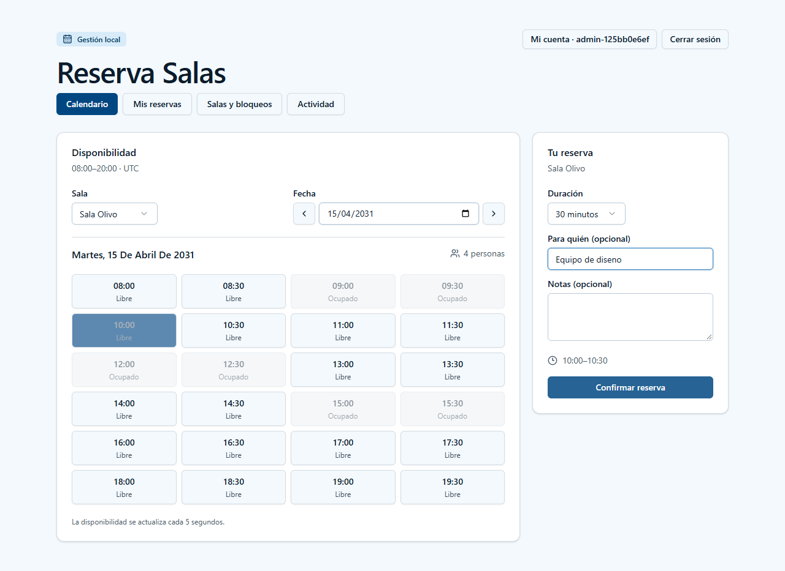
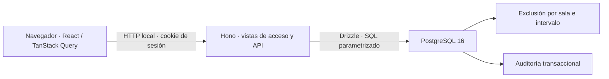

# Reserva Salas

[](https://github.com/Nivi018/reserva-salas/actions/workflows/ci.yml)

Aplicación web local para administrar salas de reuniones. El reto principal: **si dos personas reservan la misma sala para horarios que se superponen, PostgreSQL garantiza que solo una solicitud se confirme**. La aplicación no depende de que el calendario esté actualizado para tomar esa decisión.

**Stack:** TypeScript · React · Tailwind CSS · shadcn/ui · TanStack Query · Hono RPC · Drizzle ORM · PostgreSQL 16 · Docker Compose.



*Captura local con datos ficticios.*

## Qué se puede hacer

- **Mis reservas:** próximas y en curso, historial, reprogramación y cancelación. Una reprogramación rechazada no modifica la reserva original.
- **Salas y bloqueos:** altas, edición, activación y desactivación, horarios diarios, zona horaria IANA y mantenimiento. Desactivar o ajustar una sala no altera las reservas ya confirmadas. Las tres salas iniciales tienen horario 08:00–20:00 y zona UTC; puedes editar esa configuración en cada sala.
- **Actividad:** registro paginado de cambios a partir de la actualización, con los datos anteriores y posteriores.
- **Cuentas locales:** inicio de sesión por correo o usuario, roles de administrador y miembro, cambio y recuperación de contraseña. Cada miembro gestiona sus propias reservas.
- **Calendario y operación:** disponibilidad actualizada cada cinco segundos en la pestaña activa, horarios por zona IANA, copias automáticas en Windows y restauración a una base separada.

El repositorio muestra el código. La aplicación no está desplegada: escucha solo en loopback y no incluye autorregistro, envío de correo, WhatsApp ni calendarios externos.

## Arranque local (PowerShell)

Requisitos: Node.js 22.13+ (rama 22) o Node.js 24, npm, PowerShell y Docker Desktop con contenedores Linux. Los comandos se ejecutan desde la raíz del repositorio.

```powershell
git clone https://github.com/Nivi018/reserva-salas.git
Set-Location reserva-salas
```

Copia `.env.example` a `.env` si no existe y configura una contraseña aleatoria para `POSTGRES_PASSWORD`. No compartas `.env` ni uses una contraseña real en la base de pruebas.

```powershell
npm ci
docker compose up -d --wait db
npm run db:migrate
npm run admin:create
npm run dev
```

`admin:create` se ejecuta una sola vez. Pide usuario, correo y una contraseña de al menos 12 caracteres sin mostrarla. Abre <http://127.0.0.1:5174> e inicia sesión con el correo o usuario. En **Mi cuenta**, el administrador puede crear, activar y desactivar miembros. Las contraseñas de los usuarios se guardan como hashes con sal (scrypt), no en `.env`.

El administrador puede ver las reservas anteriores al cambio y gestionar todas las reservas, salas, bloqueos y actividad. Cada miembro ve la disponibilidad compartida, pero solo puede listar, editar y cancelar sus propias reservas. Desactivar una cuenta o cambiar su contraseña invalida sus sesiones anteriores.

### Recuperar el acceso

- **Miembros:** entra como administrador, abre **Mi cuenta → Usuarios → Restablecer contraseña** y elige una nueva contraseña. El usuario puede cambiarla después de entrar.
- **Administrador:** si olvidaste tu contraseña, abre PowerShell en esta carpeta y ejecuta `npm run admin:recover` con Docker activo. Escribe `admin` (o el correo de la cuenta) y la contraseña nueva dos veces. Este comando se ejecuta desde Windows, no se ofrece en la pantalla pública.

Los restablecimientos cierran las sesiones anteriores y quedan en **Actividad** sin registrar la contraseña.

El calendario y su API requieren una sesión. Las sesiones duran hasta ocho horas y se invalidan al usar **Cerrar sesión** o reiniciar el servidor. La app y PostgreSQL escuchan únicamente en `127.0.0.1`; el puerto de PostgreSQL se configura en `.env`. No expongas el servicio mediante túneles o reenvío de puertos. Un administrador del equipo o alguien que use tu cuenta de Windows no está aislado por esta configuración.

Conserva `.env` tras inicializar el volumen: cambiar `POSTGRES_PASSWORD` allí no cambia el usuario existente en PostgreSQL. Para detener la base sin borrar datos, usa `docker compose down`.

## Arquitectura y concurrencia



- **`client/`**: calendario y gestión; consume el contrato de la API mediante Hono RPC.
- **`server/src/`**: validación, sesiones, permisos y persistencia. **`server/drizzle/`** contiene las migraciones versionadas.
- **`scripts/`**: copia y restauración, recuperación del administrador y automatización local en Windows.

La disponibilidad visible es orientativa: se consulta periódicamente y puede cambiar antes de pulsar **Confirmar reserva**. La restricción de exclusión GiST (`btree_gist`) une la sala con el intervalo `tstzrange` `[inicio, fin)` de las reservas y bloqueos no cancelados. Se evalúa al escribir y funciona aunque las solicitudes lleguen en paralelo. Un solapamiento se convierte en HTTP `409`; los intervalos contiguos sí pueden coexistir. Una reprogramación rechazada conserva la reserva original, y la auditoría registra solo cambios que se aplican.

La regla está en la [migración SQL](server/drizzle/0004_management_rules.sql) y el escenario concurrente se verifica en la [prueba de integración](server/src/bookings.integration.test.ts).

### API

| Ruta | Resultado |
| --- | --- |
| `GET /api/health` | Disponibilidad del proceso HTTP; no verifica PostgreSQL. |
| `GET /api/profile` | Usuario y rol de la sesión. |
| `GET /api/rooms` | Lista de salas activas. |
| `GET /api/availability` | Devuelve los intervalos ocupados. Recibe `roomId`, `startsAt` y `endsAt` por query, con fechas ISO 8601 que incluyan zona horaria y un intervalo de hasta 48 horas. |
| `POST /api/bookings` | Crea una reserva; admite `bookedFor` y `notes`. |
| `GET /api/bookings`, `PATCH /api/bookings/:id` | Lista próximas o historial y reprograma/edita con número de versión. |
| `POST /api/bookings/:id/cancel`, `POST /api/blocks` | Cancela una reserva, retira un bloqueo o crea mantenimiento. |
| `GET/POST /api/manage/rooms`, `PATCH /api/manage/rooms/:id` | Consulta, alta y actualización de salas. |
| `GET /api/manage/audit` | Historial paginado de cambios. |

Las rutas requieren sesión. Las escrituras del navegador requieren el origen local esperado. El administrador accede también a la gestión de salas, bloqueos y auditoría; los miembros solo gestionan reservas propias.

## Copias y restauración

Con Docker activo y desde la raíz:

```powershell
npm run db:backup
npm run db:backup:verify -- backups/NOMBRE.dump
npm run db:restore -- backups/NOMBRE.dump reserva_restaurada_revision
```

- El primer comando genera una copia PostgreSQL en `backups/` y muestra su ruta. El directorio está excluido de Git. Los archivos contienen datos privados, no los compartas; guarda una copia adicional en una ubicación privada separada.
- Verificar restaura a una base temporal, comprueba el esquema, el registro y las reglas de exclusión, y elimina esa base temporal. No altera la base activa.
- Restaurar requiere un **nombre nuevo** y deja la base recuperada separada; nunca reemplaza la activa. Inspecciona la copia antes de ponerla en uso. Para usarla en la aplicación, conserva la base original y cambia `POSTGRES_DB` en `.env` al nombre recuperado. Ejecuta `docker compose up -d --wait db` (sin borrar el volumen) y reinicia la aplicación. Conserva el usuario y la contraseña del servidor PostgreSQL existente.
- Las copias incluyen los datos y migraciones registrados, no el archivo `.env`. La verificación de reglas de gestión está pensada para copias hechas después de esta actualización.

### Copias automáticas en Windows

`npm run db:backup:schedule` configura las copias para tu cuenta de Windows, sin publicar ni iniciar la app. Si Windows permite registrar una tarea, se ejecuta a las 20:00 y al iniciar sesión. Si no lo permite, se instala un acceso directo en la carpeta de inicio de tu usuario: intenta la copia al abrir sesión y reintenta cada 30 minutos mientras la sesión esté abierta. En ambos casos Docker y PostgreSQL deben estar disponibles.

Se guarda como máximo una copia verificada por día en `%LOCALAPPDATA%\ReservaSalas\Copias`, fuera del proyecto. Se conservan las 14 copias automáticas verificadas más recientes. Cada copia se publica solo después de restaurarla en una base temporal. El último resultado aparece en `estado.txt` en esa carpeta. Para ejecutar una copia ahora, usa `npm run db:backup:daily`. Estas copias son locales; para recuperarte de un fallo del disco guarda también una copia en otro medio privado.

Para desactivar el arranque de las copias, deshabilita la tarea **Reserva Salas - Copia local diaria** si existe, o elimina el acceso directo del mismo nombre en `shell:startup` y cierra sesión en Windows para detener el proceso actual. Las copias guardadas no se borran.

### Arranque automático opcional en Windows

No se instala ni se activa por defecto. Si lo quieres, añade un acceso directo en `shell:startup` que ejecute el siguiente archivo (Docker Desktop debe estar instalado). Sigue siendo local y pide iniciar sesión.

```text
powershell.exe -NoProfile -File "<ruta-al-repositorio>\scripts\start-local.ps1"
```

## Verificaciones y migraciones

```powershell
npm run typecheck
npm run lint
npm test
npm run build
docker compose config --quiet
```

Las pruebas unitarias del contrato no requieren Docker. Para repetir la prueba de integración en un proyecto Compose aislado, usa una base cuyo nombre termine en `_test` y un puerto libre distinto al de desarrollo. Crea `.env.test` desde `.env.example`, sin sobrescribirlo si ya existe, y cambia `POSTGRES_DB` a `reserva_salas_test`, `POSTGRES_PORT` a `55441` y `POSTGRES_PASSWORD` a una contraseña nueva. Luego ejecuta:

```powershell
docker compose -p reserva-salas-test --env-file .env.test up -d --wait db
npm run test:integration
docker compose -p reserva-salas-test --env-file .env.test down
```

La integración aplica las migraciones contra PostgreSQL 16 y comprueba que dos solicitudes HTTP simultáneas devuelven `201` y `409`, con una sola fila almacenada. También prueba horarios contiguos, reservas frente a bloqueos, recuperación de cuentas, revocación de sesiones y privacidad entre miembros. [GitHub Actions](https://github.com/Nivi018/reserva-salas/actions/workflows/ci.yml) ejecuta el build, lint y ambas suites; no despliega la aplicación.

Tras cambiar el esquema, usa `npm run db:generate -- --name=nombre` y después `npm run db:migrate`. La exclusión y la auditoría se mantienen en migraciones SQL personalizadas.
