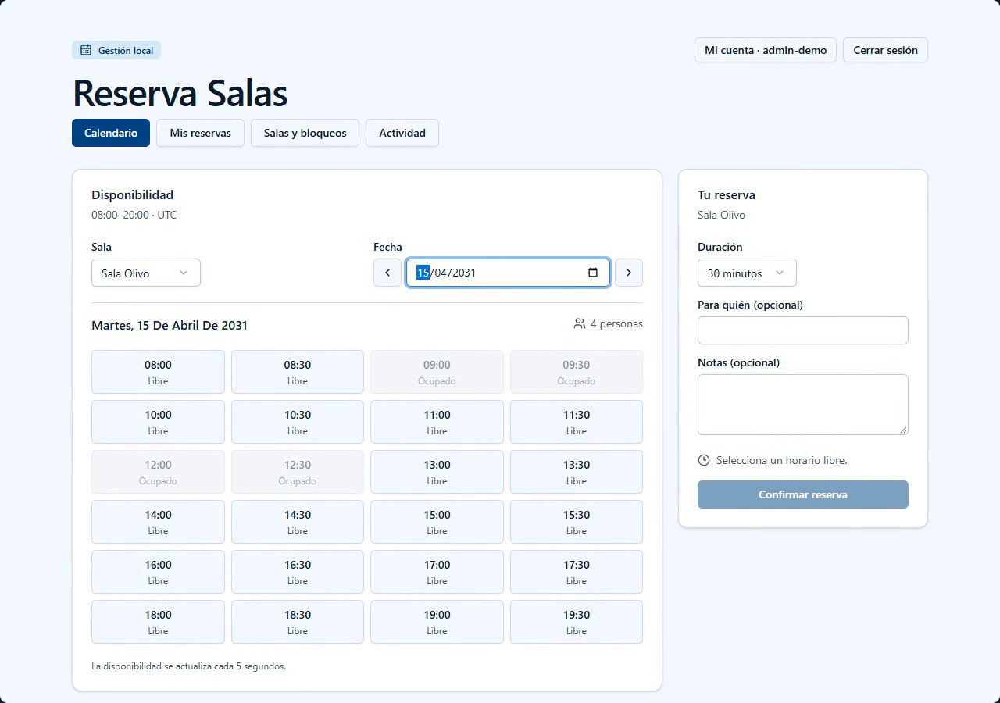
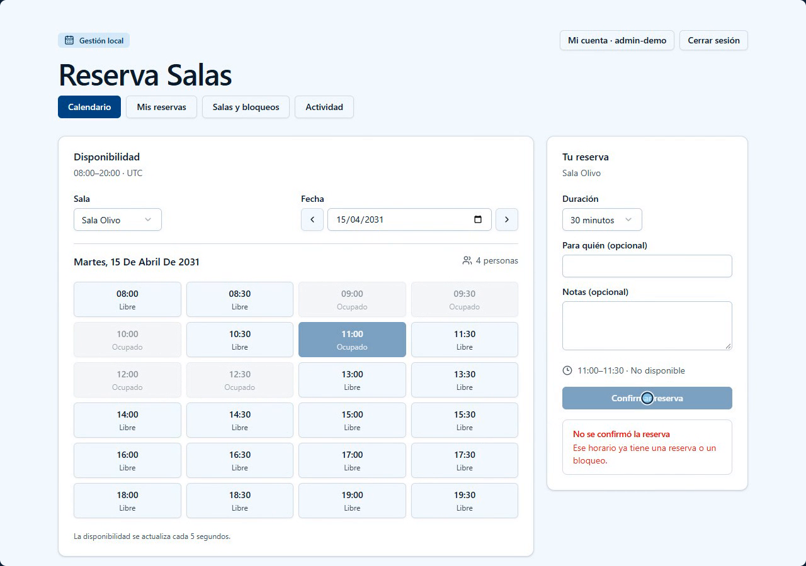
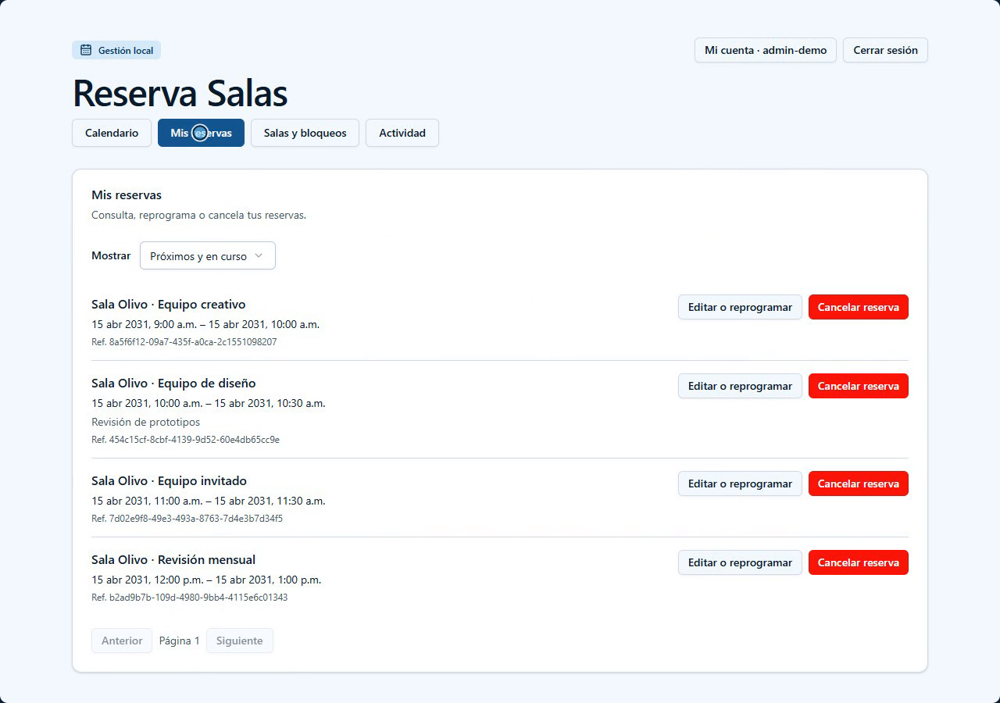

# Demostración de Reserva Salas

- **[Video de demostración · GitHub Release](https://github.com/Nivi018/reserva-salas/releases/tag/demo-v1)** · [Descargar MP4](https://github.com/Nivi018/reserva-salas/releases/download/demo-v1/reserva-salas-demo.mp4). Recorrido narrado en español (1:11), grabado en Chrome y montado con Hyperframes. El video no usa las capturas como fuente.
- [`ver-demo.html`](ver-demo.html): reproductor y galería para abrir en el navegador después de clonar. Si quieres reproducirlo sin conexión, descarga el MP4 y colócalo al lado del HTML.
- [`reserva-salas-demo.srt`](reserva-salas-demo.srt): subtítulos en español. Se pueden abrir junto con el MP4 en un reproductor compatible.
- [`capturas/`](capturas/): vistas y estados principales de la aplicación. Hyperframes exporta los fotogramas desde la grabación original.
- [`hyperframes/index.html`](hyperframes/index.html): composición editable de Hyperframes, con la grabación y la voz por capítulos.
- [`guion.json`](guion.json): títulos, leyendas y texto de la narración.
- [`hyperframes/capitulos.txt`](hyperframes/capitulos.txt): tiempos de inicio de cada capítulo.

El material usa una base PostgreSQL desechable con cuentas, reuniones y notas ficticias. No se graba la instancia de uso diario.

| Calendario | Conflicto simultáneo | Mis reservas |
| --- | --- | --- |
| [](capturas/02-calendario.png) | [](capturas/04-resultado-solicitudes-simultaneas.png) | [](capturas/05-mis-reservas.png) |

## Cómo se produjo

En Windows, con la app compilada (`npm run build`), Chrome, FFmpeg, FFprobe y una voz local de español en PowerShell:

1. Configura las variables PostgreSQL para una base **vacía y aislada** cuyo nombre termine en `_test`. No uses los valores de la base de uso diario.
2. Configura `DEMO_TOOLS` con la ruta de una carpeta que tenga `playwright-core` y `hyperframes@0.9.99` instalados. Instala el binario de captura con `playwright-core install ffmpeg` si el equipo aún no lo tiene.
3. Desde la raíz, prepara la voz, graba las interacciones y genera la composición:

   ```powershell
   powershell -NoProfile -File demo/voz.ps1
   node demo/capture.mjs
   node demo/compose.mjs
   ```

4. Exporta el MP4 y las capturas:

   ```powershell
   powershell -NoProfile -File demo/exportar.ps1 -Hyperframes "$env:DEMO_TOOLS\node_modules\.bin\hyperframes.cmd"
   ```
